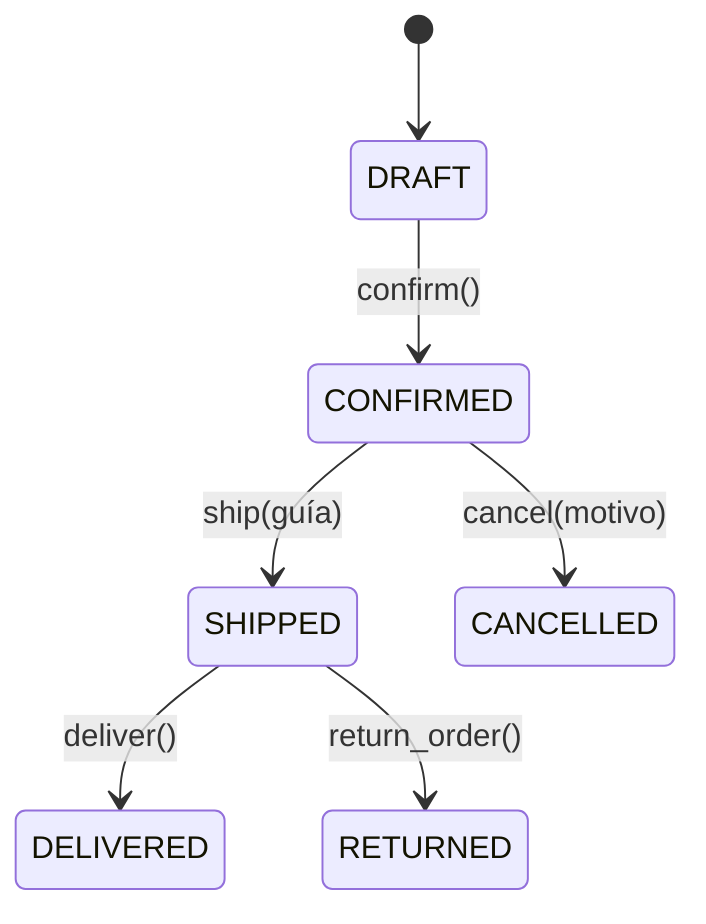

# TechStore U4 · Núcleo de negocio

Práctica Guiada · Actividad 4 — Componentes de Lógica de Negocio, FIME · UANL.
Administra pedidos de una tienda ficticia: lee clientes, productos y pedidos desde CSV,
aplica reglas de descuento, controla el estado de cada pedido y expone una API REST.
Todo funciona **en memoria** (no hay base de datos): al cerrar el programa se pierden los cambios.

## Estructura

```
techstore-u4/
  datos/                  # 5 CSV (clientes, productos, pedidos, detalle_pedidos, escenarios)
  cargar_csv.py           # carga los CSV a objetos del dominio
  ejecutar_escenarios.py  # ejecuta E01–E15 y genera docs/bitacora_escenarios.md
  app/
    domain.py             # Money, Customer, OrderItem, Order, DomainEvent, excepciones
    specifications.py     # Specification (AND/OR/NOT) y reglas de descuento
    api.py                # API REST con FastAPI
  tests/                  # test_domain.py, test_api.py
  docs/bitacora_escenarios.md
```

## Instalación

Requiere Python 3.11 o superior.

```bash
python -m venv .venv
# Windows PowerShell: .venv\Scripts\Activate.ps1
# Windows CMD:        .venv\Scripts\activate.bat
# macOS / Linux:      source .venv/bin/activate
python -m pip install -r requirements.txt
```

## Ejecución

```bash
python cargar_csv.py              # muestra los 16 pedidos (todos DRAFT)
python ejecutar_escenarios.py     # corre E01–E15 y escribe la bitácora
python -m pytest -q               # pruebas automáticas
uvicorn app.api:app --reload      # API; docs en http://127.0.0.1:8000/docs
```

## Reglas de negocio

- `Money` es inmutable, usa `Decimal`, rechaza montos negativos o no finitos y solo suma monedas iguales (MXN).
- `OrderItem`: SKU no vacío y cantidad > 0. El subtotal se calcula (`precio × cantidad`).
- Máximo **20 unidades por pedido** (suma de cantidades, no número de renglones). Solo se agregan artículos en `DRAFT` y solo en MXN.
- **Descuento 10 %**: cliente VIP **y** total `> 500` **y** `>= 4` unidades **y** sin promoción activa.
- **Descuento 5 %**: total `> 5000` **y** sin promoción activa.
- Si se cumplen ambas, aplica 10 %. Con promoción activa no hay descuento.
- No se controla inventario (la `existencia` del catálogo es solo informativa).

## Máquina de estados y Domain Events



| Operación | Requisitos | Evento |
| --- | --- | --- |
| `confirm()` | estado DRAFT, con artículos y cliente activo | `OrderConfirmed` |
| `ship(guía)` | estado CONFIRMED y guía no vacía | `OrderShipped` |
| `cancel(motivo)` | estado CONFIRMED y motivo no vacío | `OrderCancelled` |
| `deliver()` | estado SHIPPED | `OrderDelivered` |
| `return_order()` | estado SHIPPED | `OrderReturned` |

En cada método se **valida primero, se cambia el estado después y el evento se registra al final**.
Así, una operación inválida no cambia el estado ni agrega eventos.

## Endpoints

| Método | Ruta | Descripción | Respuestas |
| --- | --- | --- | --- |
| GET | `/orders` | Lista resumida de pedidos | 200 |
| GET | `/orders/{id}` | Detalle, descuento aplicable y eventos | 200, 404 |
| POST | `/orders/{id}/confirm` | Confirma el pedido | 200, 404, 409, 422 |
| POST | `/orders/{id}/ship` | Cuerpo: `{"tracking_number": "..."}` | 200, 404, 409, 422 |
| POST | `/orders/{id}/cancel` | Cuerpo: `{"reason": "..."}` | 200, 404, 409, 422 |
| POST | `/orders/{id}/deliver` | Marca como entregado | 200, 404, 409 |
| POST | `/orders/{id}/return` | Marca como devuelto | 200, 404, 409 |
| POST | `/orders/{id}/items` | Cuerpo: `{"sku": "SKU003", "quantity": 2}` (precio tomado del catálogo) | 201, 404, 409, 422 |

Códigos de error: **404** pedido o SKU inexistente · **409** transición de estado no permitida · **422** datos inválidos o regla incumplida (cliente inactivo, pedido vacío, guía vacía, más de 20 unidades).

Para repetir casos en Swagger sin reiniciar, se puede reiniciar el servidor; las pruebas usan `reset_orders()` de `app/api.py`.
